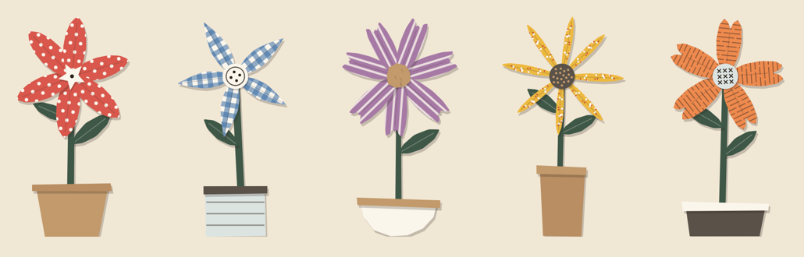
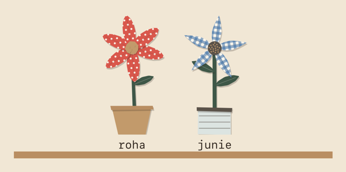
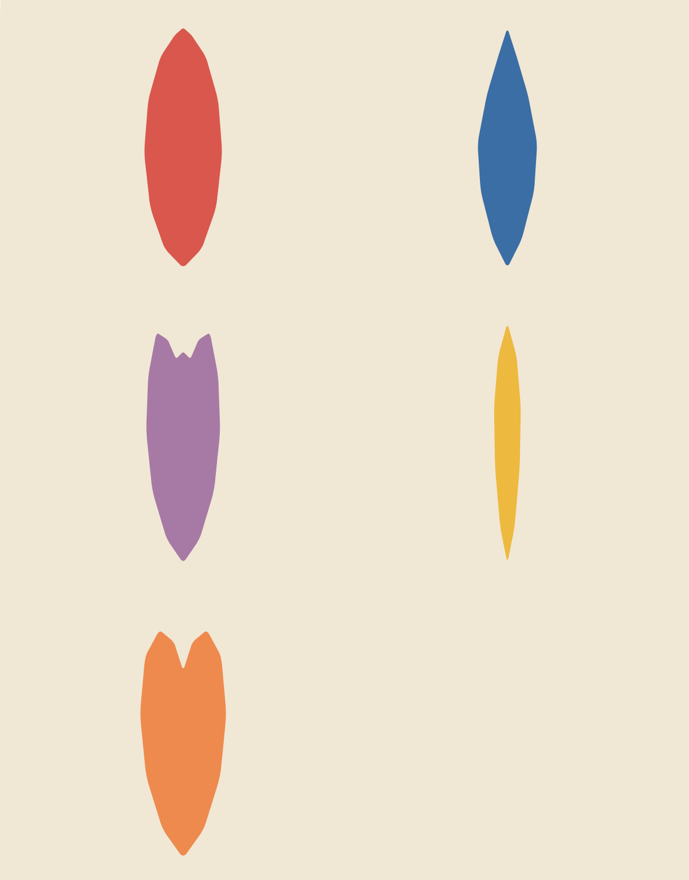
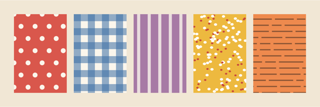

# Windowsill

A shared paper-collage windowsill for 2–6 close friends, living in iPhone home-screen widgets (and later a Mac desktop widget and menu-bar panel).

Each friend cuts one petal from patterned paper folded in half. The app mirrors it across the fold and repeats it around a centre to make that friend's flower. Everyone's flowers sit side by side in pots on one sill.

See [PLAN.md](PLAN.md) for the milestones and [CLAUDE.md](CLAUDE.md) for the design brief.

## Plants so far

Five sample plants. Each has its own petal shape, paper, petal count and centre (star, button, kraft disc, seeds, cross-stitch), on a paper-strip stem with one or two leaves, in one of five hand-cut pots (tapered, ridged tin, bowl, tall slim, squat) with a separate rim strip:

Small per-friend jitter (petal angles and lengths, leaf sides, pot corners) comes from a seeded random generator, so a friend's plant looks exactly the same on every phone and every render.

## The sill

Everyone's latest petal, side by side with their name. The app draws it live; the widget shows the same plants as PNGs:

## Cutouts

A petal is stored as the right half only, then mirrored across the fold. The five sample shapes are rounded, pointed, notched tip, slim and heart notch:

 

## Papers

Drawn in code for now (scanned textures come in milestone 3): dots, gingham, stripe, ditsy, newsprint.

## Project layout

| Folder | What's in it |
| --- | --- |
| `flower/` | iOS app target |
| `WindowsillWidget/` | widget extension |
| `Shared/` | code used by both: models, flower drawing, papers, Supabase |
| `WindowsillTests/` | unit tests (Swift Testing); run with ⌘U on a simulator |

## How a petal gets to a friend's widget

1. The app inserts a row into `petals_v2` (half-petal `points`, paper name, petal count).
2. The widget's timeline provider fetches each friend's latest petal.
3. `FlowerRenderer` draws any new plant to a PNG in the shared App Group.
4. The widget view only shows those images; it never draws or fetches.
