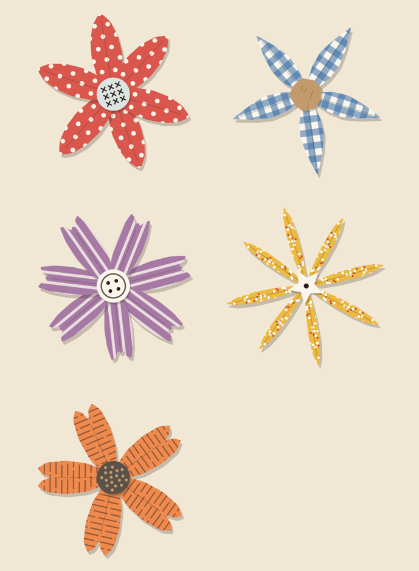
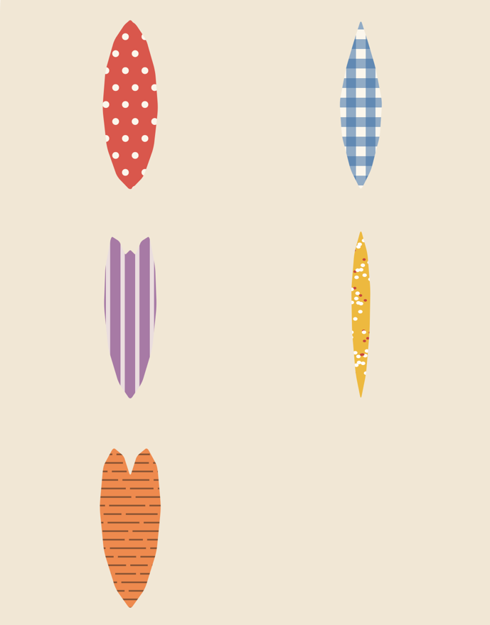

# Windowsill

A shared paper-collage windowsill for 2–6 close friends, living in iPhone home-screen widgets (and later a Mac desktop widget and menu-bar panel).

Each friend cuts one petal from patterned paper folded in half. The app mirrors it across the fold and repeats it around a centre to make that friend's flower. Everyone's flowers sit side by side in pots on one sill.

See [PLAN.md](PLAN.md) for the milestones and [CLAUDE.md](CLAUDE.md) for the design brief.

## Flowers so far

Five sample flowers, each with its own petal shape, paper, petal count and centre (cross-stitch, kraft disc, button, star, seeds):

## Cutouts

A petal is stored as the right half only, then mirrored across the fold. The five sample shapes are rounded, pointed, notched tip, slim and heart notch:

 

## Papers

Drawn in code for now (scanned textures come in milestone 3): dots, gingham, stripe, ditsy, newsprint.

## Project layout

| Folder | What's in it |
| --- | --- |
| `flower/` | iOS app target |
| `WindowsillWidget/` | widget extension |
| `Shared/` | code used by both: models, flower drawing, papers, Supabase |
