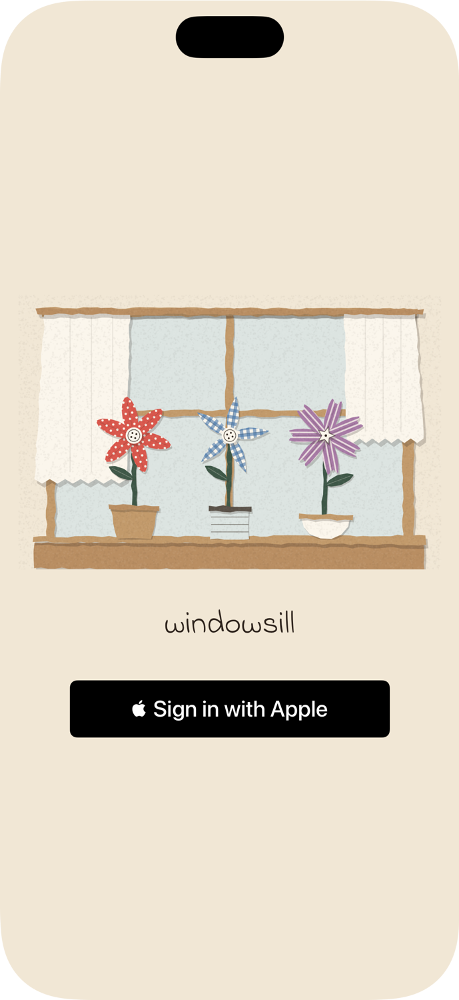
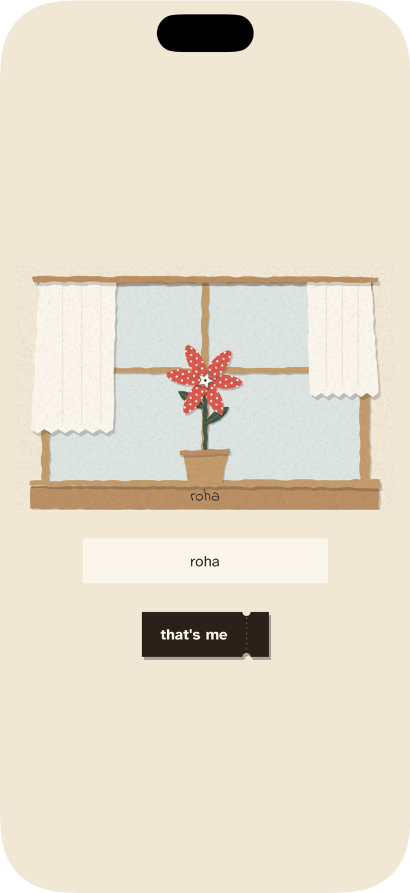
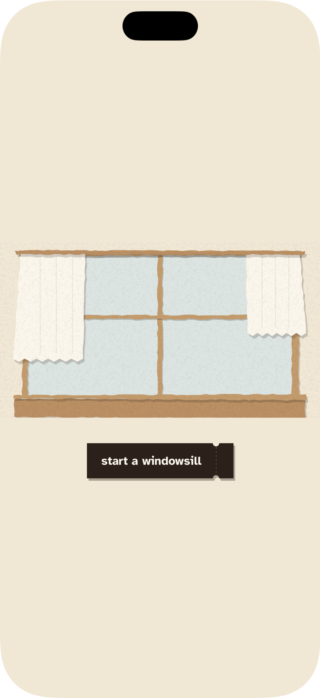
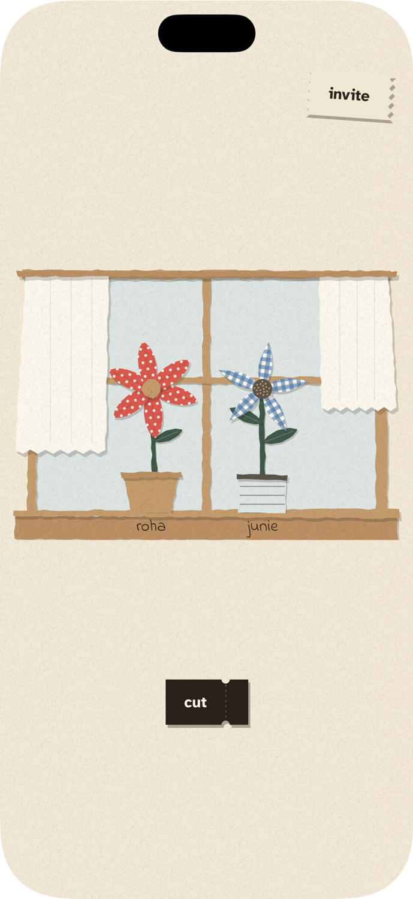
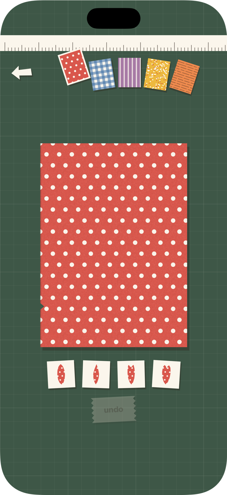
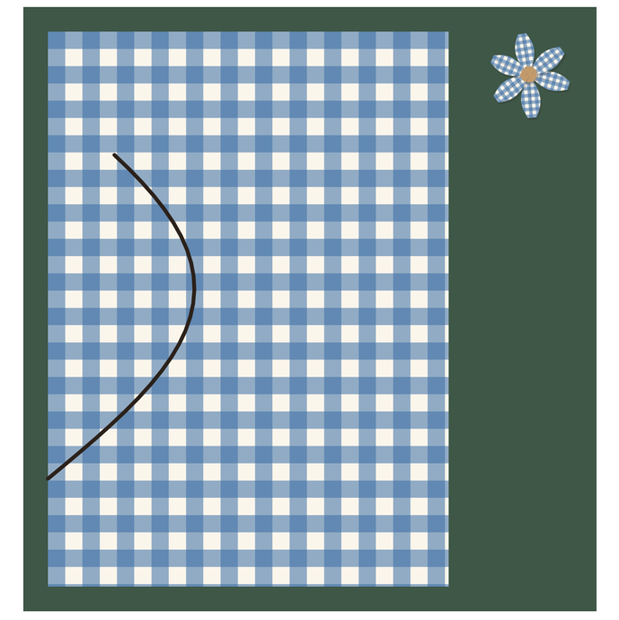
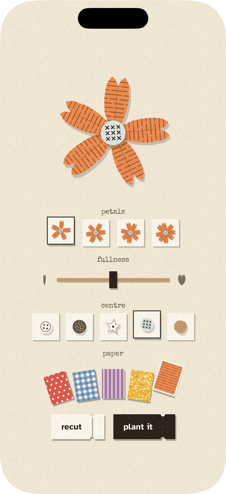
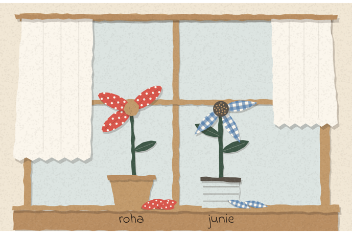
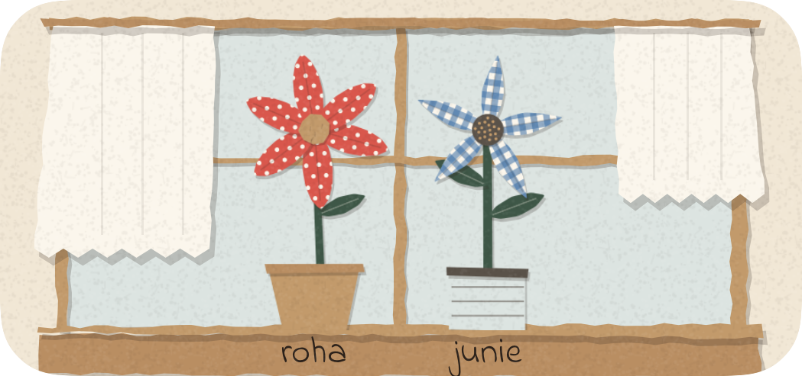

# How to use Windowsill

Windowsill is a little window you share with your friends.
Everyone makes a paper flower, and all the flowers sit together on the sill.

---

## 1. Sign in

Tap the black **Sign in with Apple** button.

---

## 2. Type your name

Type your name in the box. Your name goes under your flower pot, so your friends know it's yours.

Then tap **that's me**.

---

## 3. Make your windowsill

Tap **start a windowsill**.

Did a friend send you a link? Tap the link instead. It takes you to *their* windowsill.

---

## 4. Your windowsill

This is your window! Every friend has a flower in a pot, with their name underneath.

- Tap **invite** (the strip of tape in the corner) to send a link to your friends.
- Tap **cut** to make your flower.

---

## 5. Pick your paper

Tap one of the papers at the top. Red dots? Blue checks? You pick!

The big sheet is your paper, folded in half. **The left edge is the fold.**

Don't want to cut? Tap one of the four little petals under the paper. That makes a flower straight away.

---

## 6. Cut half a petal

1. Put your finger on the **left edge** of the paper.
2. Draw a bump out to the right, like half a heart or half a leaf.
3. Come back to the **left edge**.

The knife cuts a little bit above your finger, so you can always see the line.

While you cut, a **tiny flower** in the top corner shows what your flower will look like.

Oops? Tap **undo**. Lifted your finger too soon? Put it back on the end of your line and keep going.

When you're done, tap **cut**.

---

## 7. Make it yours

Your petal opens up into a whole flower! Now you can change it:

| | What it does |
|---|---|
| **petals** | How many petals: 5, 6, 7 or 8 |
| **fullness** | Slide left for skinny petals, right for chubby ones |
| **centre** | The middle of your flower: a button, seeds, a star, a cross or a brown paper circle |
| **paper** | Try a different paper |

Everything changes right away, so play until you love it.

Tap **plant it** to put it on the windowsill. Tap **recut** to start again.

---

## 8. Watch out for wind!

Sometimes a gust of wind blows through. The flowers lean over, the curtains flap, and a petal or two blows off onto the sill.

Want a full flower again? Cut a new one!

If you don't plant for a long while, your flower gets sleepy and droops. A new flower wakes it up.

---

## 9. Put it on your home screen

You can see your friends' flowers without opening the app.

**On iPhone:**
1. Press and hold an empty spot on your home screen until the apps wiggle.
2. Tap **Edit**, then **Add Widget**.
3. Find **Windowsill** and pick a size.
4. Tap **Add Widget**.

When a friend plants a new flower, it shows up on your home screen too.

**On a Mac:** click the little flower at the top of your screen (in the menu bar) to open your windowsill. You can also add the Windowsill widget to your desktop.

---

That's it! Cut a flower, invite your friends, and watch your windowsill fill up.
